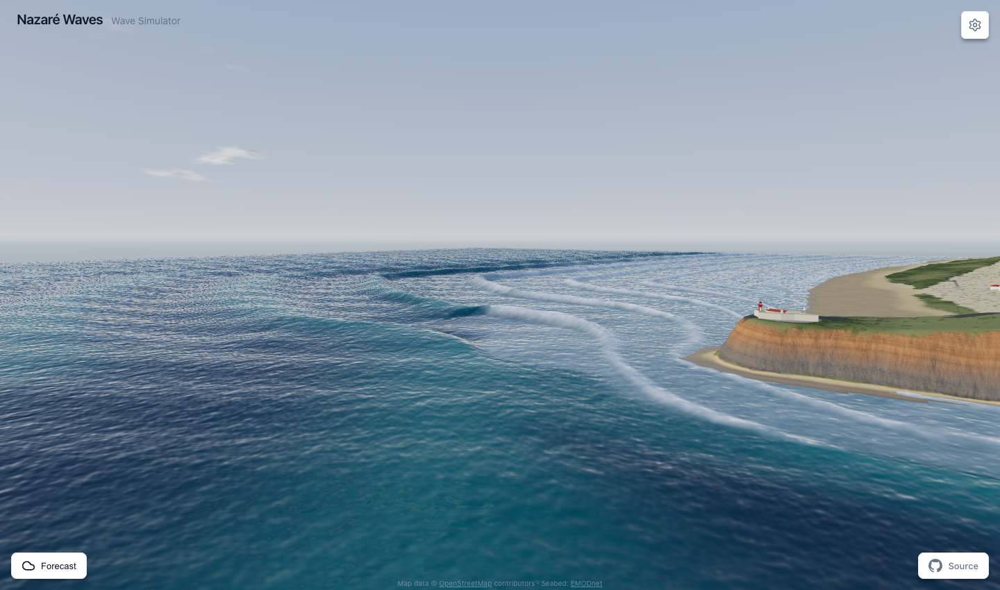

<p align="center">
  
</p>

<h1 align="center">Nazaré Waves Simulator</h1>

<p align="center">
  A 3D wave simulator inspired by the famous Nazaré waves in Portugal.<br />
  Built with React, Three.js, and TypeScript.
</p>

<p align="center">
  <a href="https://nazarewav.es"><strong>nazarewav.es</strong></a>
  ·
  <a href="https://wittchen.io/notes/nazare-waves/">blog article</a>
</p>

<p align="center">
  
</p>

## Features

- **Animated 3D Wave Mesh** - Realistic wave simulation with configurable parameters
- **Canyon Effect** - Swell refracted and reflected by the northern rim of the Nazaré Canyon over the real seabed, with the interference beams and pyramid peaks described by Hope et al. (2026)
- **Wireframe/Solid Display** - Toggle between grid mesh and solid surface rendering
- **Natural Wave Movement** - Waves propagate naturally toward the viewer
- **Real-time Controls** - Adjust all parameters with instant visual feedback
- **Presets** - Quick presets for Calm, Moderate, Big, and Extreme wave conditions
- **Dark Theme UI** - Clean, minimalistic interface inspired by shadcn/ui

## Installation

```bash
bun install
```

## Usage

```bash
# Development server
bun dev

# Production build
bun run build

# Preview production build
bun run preview
```

## Configuration

All wave parameters can be configured in one place: `src/config/waveConfig.ts`

### Wave Parameters

| Parameter | Description | Default |
|-----------|-------------|---------|
| `waveHeight` | Base wave height in meters | 8 |
| `wavePeriod` | Time between wave crests in seconds | 14 |
| `waveDirection` | Direction waves come from (0° = toward viewer) | 0 |
| `waveLength` | Distance between wave crests in meters | 200 |

### Secondary Wave (Cross Swell)

| Parameter | Description | Default |
|-----------|-------------|---------|
| `secondaryWaveHeight` | Secondary swell height | 2 |
| `secondaryWavePeriod` | Secondary swell period | 8 |
| `secondaryWaveDirection` | Secondary swell direction | 30 |

### Wind Parameters

| Parameter | Description | Default |
|-----------|-------------|---------|
| `windSpeed` | Wind speed in m/s | 15 |
| `windDirection` | Wind direction in degrees | 45 |
| `windChopIntensity` | Small wave chop intensity (0-1) | 0.3 |

### Canyon Effect

| Parameter | Description | Default |
|-----------|-------------|---------|
| `canyonAmplification` | Strength of the computed refraction and reflection (1 = real seabed, 0 = none) | 1 |

### Display Options

| Parameter | Description | Default |
|-----------|-------------|---------|
| `wireframe` | Display as wireframe grid mesh | false |
| `animateWaves` | Enable natural wave movement | true |
| `timeScale` | Animation speed multiplier | 1.0 |

## Controls

- **Mouse Drag** - Orbit camera around the scene
- **Scroll** - Zoom in/out
- **Control Panel** - Adjust all wave parameters in real-time

## Tech Stack

- [Bun](https://bun.sh/) - JavaScript runtime and package manager
- [React](https://react.dev/) - UI framework
- [Three.js](https://threejs.org/) - 3D graphics library
- [React Three Fiber](https://docs.pmnd.rs/react-three-fiber) - React renderer for Three.js
- [React Three Drei](https://github.com/pmndrs/drei) - Useful helpers for R3F
- [TypeScript](https://www.typescriptlang.org/) - Type safety
- [Vite](https://vitejs.dev/) - Build tool

## About Nazaré

Nazaré is a fishing village in Portugal famous for having some of the largest waves in the world. The Nazaré Canyon, an underwater canyon that extends for about 230 km, refracts and reflects long-period Atlantic swell along its northern rim and focuses it on Praia do Norte. This simulator recreates that from real data: the coast, town and seabed are surveyed and to scale, and rays traced over the bathymetry decide where the energy lands, including the shadow over the canyon. Nothing about the amplification is hand-placed.

## Geodata

The binaries in `src/data` are baked by `node scripts/bake-nazare.mjs <rawDataDir>` from:

- Bathymetry: [EMODnet Bathymetry](https://emodnet.ec.europa.eu/en/bathymetry) DTM (WCS, ~115 m)
- Land elevation: [Mapzen/AWS Terrain Tiles](https://registry.opendata.aws/terrain-tiles/), Terrarium format, zoom 14 (EU-DEM over Europe, © European Union, Copernicus)
- Coastline, buildings, roads, land cover: © [OpenStreetMap](https://www.openstreetmap.org/copyright) contributors, ODbL

The propagation model follows Hope et al. (2026), see [References](#references).

## Wave model

`src/utils/waveField.ts` applies the findings of Hope et al. (2026):

- **Refraction, not channelling.** Rays are traced over the EMODnet seabed. The shelf slopes down towards the canyon rim, which turns the swell so it meets the rim more obliquely, and the canyon casts a shadow where it turns north by the fort.
- **Reflection at the rim.** Where rays cross the 50 m contour, the boundary the study used, they split by the reflection coefficient of a trench, the plane-wave approximation of Kirby & Dalrymple (1983) with h1 ≈ 20 m and h2 ≈ 150 m. Long-period swell is reflected, completely above the critical angle. Waves shorter than about 7 s, or meeting the rim nearly head on, pass through. The model reproduces the paper's cut-offs: near-total reflection of swell from 300° above about 10 s on the outer edge and 12 s on the middle one, with the inner edge mostly transmitting.
- **Interference beams.** The reflected rays carry their own phase and are summed coherently with the incident swell near the rim. Further away the sum becomes incoherent, because over the directional spread the two drift out of step. This produces the beams of focused energy towards Praia do Norte, with peaks along them and gaps between.
- **Pyramid peaks.** Crossing seas hold higher crests before breaking (McAllister et al., 2024), so the depth-limited breaker index is raised where the two trains cross.
- Shoaling follows linear wave theory and is only a small factor at the rim (1.1–1.3 at 10–20 m for 20 s swell). The paper's swell attenuation (µ = 3.7·10⁻⁷ m⁻¹) is negligible over the 16 km grid and is left out.

## References

- Hope, G., Rainville, E. J., Seldal, T. I., Vieira, M., Bergamasco, F., Breivik, Ø., Almeida, P., Benetazzo, A., Halsne, T., Bonanad, C., and Furevik, B. R.: *Focusing of Swell at the Nazaré Submarine Canyon*, EGUsphere preprint, 2026, https://egusphere.copernicus.org/preprints/2026/egusphere-2026-2778/ ([doi:10.5194/egusphere-2026-2778](https://doi.org/10.5194/egusphere-2026-2778), CC BY 4.0; a copy is in [`docs/egusphere-2026-2778.pdf`](docs/egusphere-2026-2778.pdf))
- Kirby, J. T. and Dalrymple, R. A.: *Propagation of Obliquely Incident Water Waves over a Trench*, Journal of Fluid Mechanics, 133, 47–63, 1983
- McAllister, M. L. et al.: *Three-Dimensional Wave Breaking*, Nature, 633, 601–607, 2024

## Deployment

The app is automatically deployed to GitHub Pages on every push to `master` branch.

To enable GitHub Pages deployment:

1. Go to repository **Settings** → **Pages**
2. Under **Source**, select **GitHub Actions**
3. Push to `master` branch to trigger deployment

## License

GPL
